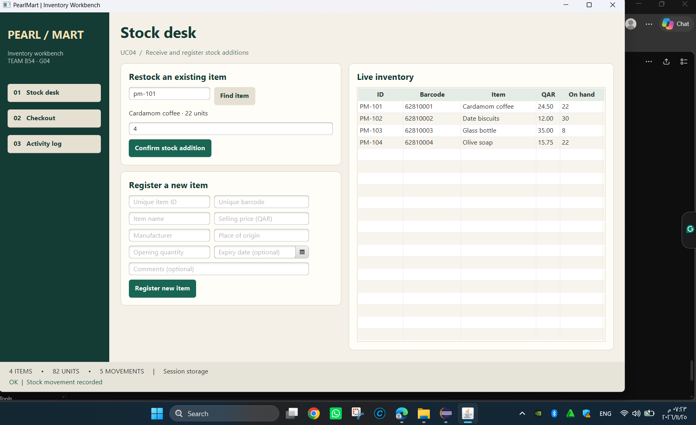
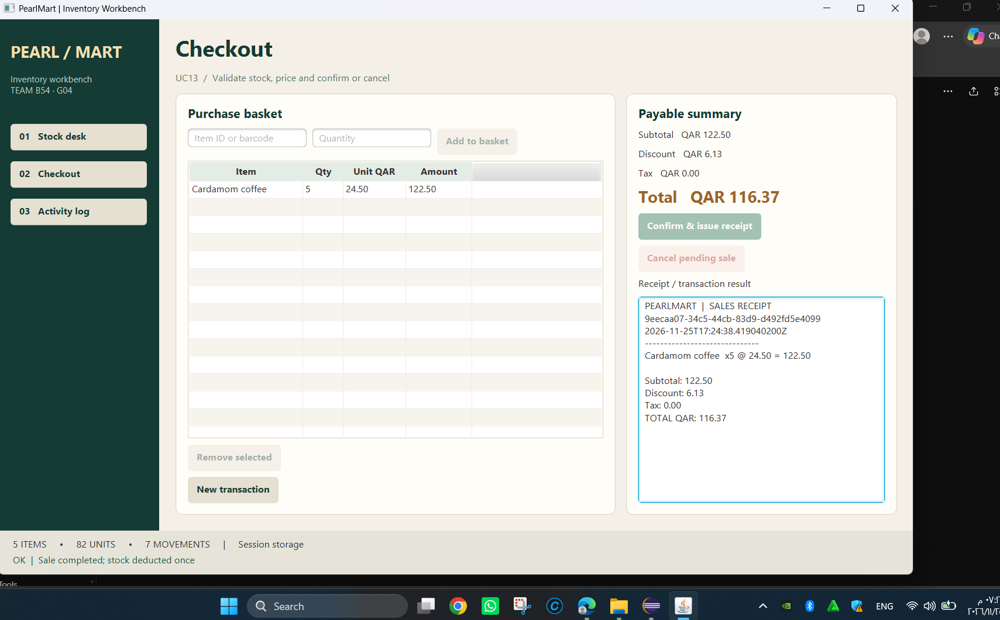
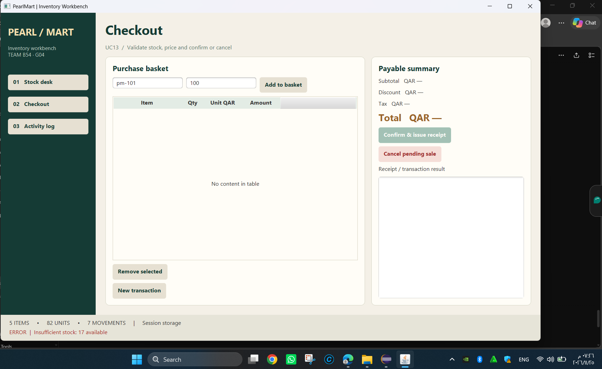
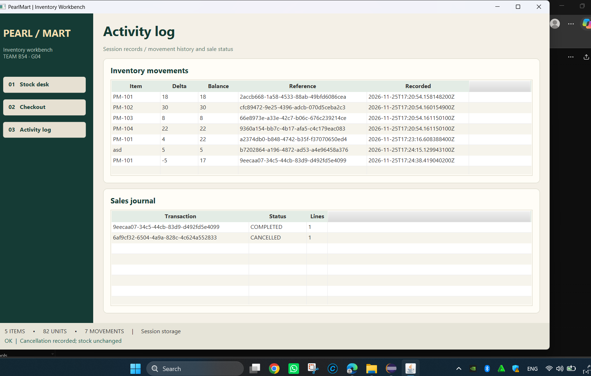

# PearlMart | Inventory Workbench

**CMPS310 · Software Engineering · Fall 2026 · Team B54-G04**

## Milestone 2 — Focused design, implementation, testing and Scrum

A JavaFX desktop prototype for UC04 Add Goods and UC13 Process Sale, using a shared in-memory inventory, receipt generation, inventory movements, and cancellation without stock deduction.

**Status:** Windows GUI demonstrated; Java core scenario results documented. Native Visual Paradigm models, peer review and final submission remain subject to team verification. The project package is being staged; screenshot and source links become available once the corresponding files are pushed.

### Team and backlog

| Member | Responsibility | Issues |
|---|---|---|
| @Maryam-alsulaiti | UML and architecture | #12, #13, #16 |
| @ghadafetais | Inventory and Stock Desk | #17, #19 |
| @shaikha220 | Checkout and patterns | #14, #15 |
| @aljoharaaa | NFRs, testing, report and Scrum | #18, #20, #21 |

[Milestone 2 backlog](https://github.com/shaikha220/team-b54-g04/issues?q=is%3Aissue+M2) · [Project board](https://github.com/users/shaikha220/projects/2/views/1)

### Run on Windows

Install JDK 21 and Maven. From the `Milestone-2` folder:

```powershell
mvn clean javafx:run
powershell -ExecutionPolicy Bypass -File scripts/test-core.ps1
```

### Application screenshots

**Stock Desk — register new goods or restock existing items**



**Checkout — confirm a sale and issue a receipt**



**Validation — insufficient inventory**



**Activity log — completed and cancelled transactions**



### Design and deliverables

- [Source and project instructions](Milestone-2/README.md)
- [UML diagrams](Milestone-2/design/)
- [Testing evidence](Milestone-2/evidence/)
- [Project report](Milestone-2/report/)
- [Scrum planning](Milestone-2/scrum/)
- Structural pattern: Facade. Behavioral pattern: Strategy.
- Testing Route A; actual evidence is distinguished from pending verification.

---

## Milestone 1 — Archived project overview


Course:CMPS310 – Software Engineering  
Semester: Fall 2026  
Milestone: Milestone 1 – Software Requirements Analysis, Design, and Agile Project Management

Project Overview

The PearlMart Inventory Management System is designed to automate inventory activities, including product management, supplier orders, billing transactions, and inventory reporting.

This milestone focuses on requirements analysis, object-oriented design, and Scrum project management.

Team Members and Scrum Responsibilities

| Team Member | GitHub Username |
|---|---|
| Member 1 | @ghadafutais | 
| Member 2 | @alljoharaaa | 
| Member 3 | @Maryam-alsulaiti | 
| Member 4 | @shaikha220 | 

Product Goal

Analyze and design an integrated inventory management system that improves inventory tracking, supports business transactions, and maintains accurate records.

Definition of Done

A task is considered complete when:
- All acceptance criteria are satisfied.
- Work is reviewed by another team member.
- Required corrections are completed.
- Final files are consistent and saved in GitHub.

Scrum Planning

The project is divided into two Sprints.

Sprint 1: Requirements Analysis
- Develop Data Flow Diagrams.
- Create the Use Case Diagram.
- Prepare Use Case Specifications.

Sprint 2: System Design and Finalization
- Create the Design Class Diagram.
- Explain object-oriented principles.
- Review and finalize the project report.

GitHub Project

Project Board: https://github.com/users/shaikha220/projects/2/views/1

GitHub Milestone: https://github.com/shaikha220/team-b54-g04/milestone/1

Repository: https://github.com/shaikha220/team-b54-g04

Project Deliverables

- Level 0, Level 1, and Level 2 DFDs
- Use Case Diagram
- Four Use Case Specifications
- Design Class Diagram
- Scrum Management Evidence
- Final Word Report and Visual Paradigm Files

Submission Deadline: October 18, 2026
